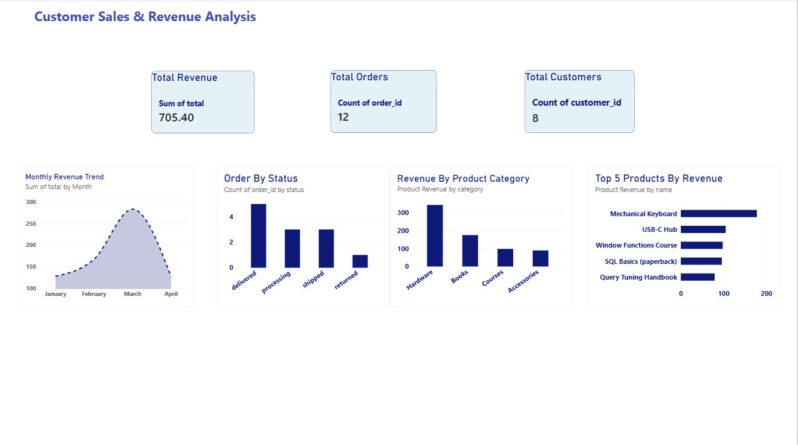

# Customer Sales & Revenue Analysis

## Project Overview
This project analyses customer, product, order, and order-item data using SQL and Microsoft Power BI. The goal is to explore sales performance, revenue trends, product performance, and order status to support data-driven business decisions.

## Tools & Technologies
- **SQL:** Data exploration, data quality checks, joins, aggregations, and business analysis
- **Microsoft Power BI:** Data modelling, DAX measures, KPI cards, and interactive visualisations
- **GitHub:** Project version control and portfolio presentation

## Dataset
The project uses four related tables:
- **Customers:** Customer details and signup dates
- **Products:** Product names, categories, and prices
- **Orders:** Order dates, statuses, and recorded order totals
- **Order Items:** Products purchased, quantities, and unit prices

## Power BI Dashboard
The dashboard includes:
- **Total Revenue:** 704.50
- **Total Orders:** 12
- **Total Customers:** 8
- **Monthly Revenue Trend:** Monthly order totals over time
- **Revenue by Product Category:** Revenue generated by each category
- **Orders by Status:** Distribution of orders by status
- **Top 5 Products by Revenue:** Products ranked by item-level revenue

## Business Questions
1. How much revenue was recorded, and how many orders and customers were included?
2. How did recorded order totals change month by month?
3. Which product categories generated the most item-level revenue?
4. How were orders distributed across different statuses?
5. Which five products generated the highest item-level revenue?

## Data Quality & Analysis
SQL was used to check for missing values, invalid totals, duplicate identifiers, unmatched customer and product references, and consistency between order totals and order-item calculations.

## Key Note
The Total Revenue KPI uses recorded order totals and currently includes returned orders. Product-level revenue is calculated from quantity multiplied by unit price. These measures may differ because they use different calculation methods and the order totals include returned orders.

## Project Files
- `Customer_Sales_Revenue_Analysis.pbix` — Power BI dashboard
- SQL analysis files are available in the main repository.

## Skills Demonstrated
SQL querying, data quality validation, relational data modelling, DAX, KPI development, data visualisation, and business analysis.

## Dashboard Preview

